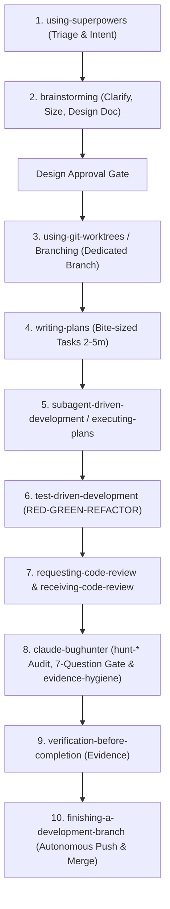

# Water Smart Bill — Rules for AI Agents (AGENTS.md)

Ref: [obra/superpowers](https://github.com/obra/superpowers) · [elementalsouls/Claude-BugHunter](https://github.com/elementalsouls/Claude-BugHunter)

This file sets the standard operational rules for all AI agents working on the **water-smart-bill** repository. Every agent session MUST strictly adhere to these guidelines.

---

## 1. Mandatory Workflow: Superpowers + Claude-BugHunter

All AI agents working on this repository **MUST EXCLUSIVELY USE THE SUPERPOWERS METHODOLOGY PAIRED WITH THE CLAUDE-BUGHUNTER SECURITY FRAMEWORK**. No improvised, ad-hoc, or unverified workflows are permitted.

> [!IMPORTANT]
> **Extremely Important Rule (`superpowers:using-superpowers` & `claude-bughunter`):**
> If you think there is even a 1% chance a Superpowers or Claude-BugHunter skill applies to what you are doing, you **ABSOLUTELY MUST** invoke the skill. This is not negotiable. Check and invoke relevant skills **BEFORE** any response, file change, or action.

### 1.1 End-to-End Development & Security Lifecycle



---

## 2. Superpowers & Claude-BugHunter Skills Matrix

| Stage / Problem | Mandatory Skill | Trigger & Required Behavior |
| :--- | :--- | :--- |
| **Session Start / Triage** | `using-superpowers` | Check for applicable skills before asking questions, exploring files, or writing code. Announce `"Using [skill] to [purpose]"`. |
| **New Features / Architecture / UI** | `brainstorming` | **HARD GATE:** Understand true goal, explore codebase, lay out 2-3 approaches with tradeoffs, size the work, draft design doc. **Nothing gets built until user approves.** |
| **Branch / Workspace Isolation** | `using-git-worktrees` | Create clean isolated workspace / branch (`feat/...`, `fix/...`, `chore/...`) from `main` before executing multi-step plans. |
| **Planning & Task Breakdown** | `writing-plans` | Break approved design into bite-sized tasks (2-5 min each) with exact file paths, full code, and verification steps in `docs/superpowers/plans/`. |
| **Implementation Engine** | `subagent-driven-development` or `executing-plans` | Execute tasks strictly against the plan. Dispatch fresh subagents per task with review, or execute inline with final review. |
| **Coding & Changes** | `test-driven-development` | **RED-GREEN-REFACTOR:** Write failing test first, watch it fail, write minimal code, watch it pass, refactor, commit. Code written before tests must be deleted. |
| **Bugs / Test Failures** | `systematic-debugging` | 4-phase root cause analysis before proposing fixes (root-cause tracing, defense-in-depth). No speculative fixes. |
| **Code Review & Quality Gate** | `requesting-code-review` & `receiving-code-review` | Rigorous verification against spec. Verify suggestions technically before implementing. |
| **Security Audit & Bug Hunting** | `claude-bughunter` (`bb-methodology`, `hunt-*`, `triage-validation`, `evidence-hygiene`) | Audit Keycloak JWT/blacklist, multi-tenant RLS, billing calculations, offline sync, and file uploads against `hunt-*` skills; apply the 7-Question Gate and secret hygiene. |
| **Pre-Completion Proof** | `verification-before-completion` | **Evidence before assertions:** Always run `cd backend-go && go test -v ./...` and `cd frontend-react && npm test` before claiming work is complete. |
| **Task / Branch Completion** | `finishing-a-development-branch` | Run full test suite, commit with conventional commit, push branch, merge into `main`, and push `main` to origin. |
| **Parallel Tasks** | `dispatching-parallel-agents` | For 2+ independent tasks that share no mutable state. |
| **Troubleshooting Agent Behavior** | `diagnosing-superpowers` | When a session misbehaves, repeats work, or burns tokens unexpectedly; analyze transcripts with line-level evidence. |
| **Skill Authoring / Modifying** | `writing-skills` | When creating or maintaining skills with TDD and drill evals. |

---

## 3. Operational Rules & Autonomous Execution

The detailed modular rules located in `.agents/rules/` are active and mandatory:

1. **Autonomous File Editing (`.agents/rules/autonomous-editing.md`):**
   - Proactively edit and apply changes to files directly without asking for user confirmation or permission to accept changes.
2. **Full Autonomous Git Workflow (`.agents/rules/git-workflow.md`):**
   - Always create a dedicated branch from primary branch (`main`).
   - Upon verification passing, autonomously commit, push task branch, merge into `main`, and push `main` to remote `origin` immediately.
3. **Architecture Decision Records (`.agents/rules/adr-tracking.md`):**
   - Before writing any ADR in `docs/adr/`, ALWAYS read `docs/adr/template.md` and strictly follow its pattern. Maintain the index table in `docs/adr/README.md`.
4. **Security & Vulnerability Hunting (`.agents/rules/security-bughunter.md`):**
   - Enforce `Claude-BugHunter` (`hunt-*`, `triage-validation`, `evidence-hygiene`) across all OIDC/JWT auth, multi-tenant RLS, billing calculation, and offline sync workflows.

---

## 4. Repository-Specific Architecture & Guidelines

- **Primary Branch:** `main`
- **Application Focus:** Smart Water Meter Billing & Utility Management System for Local Municipalities (อบต.)
- **Tech Stack:**
  - **Backend (`backend-go/`):** Go 1.24+ with Echo v4, Hexagonal Architecture (`application/`, `adapters/`), PostgreSQL with Row-Level Security (RLS)
  - **Frontend (`frontend-react/`):** React 18, TypeScript, Vite, Tailwind CSS, Vertical Slice Architecture (`src/features/`), Offline-First IndexedDB Sync, Web Bluetooth ESC/POS Printer, Hybrid OCR, LINE LIFF
  - **Auth:** Keycloak OIDC + Redis/Memory JWT `jti` Blacklist on Logout + Custom Tailwind Login Theme
- **Verification Commands:**
  ```bash
  cd backend-go && go test -v ./...
  cd ../frontend-react && npm test && npm run build
  ```
- **Documentation Invariants:**
  - Update ADR in `docs/adr/` and `docs/adr/README.md` on every architectural change.
  - Keep `docs/database/schema.md`, SQL migrations in `backend-go/db/migrations/`, and `backend-go/api/openapi.yaml` synchronized.

---

## 5. Claude-BugHunter Attack-Surface Mapping for `water-smart-bill`

When touching any of the following subsystems, invoke the mapped `claude-bughunter` skills:

| Subsystem / Module | Mandatory `claude-bughunter` Skills | Security Focus |
| :--- | :--- | :--- |
| **Keycloak OIDC & JWT Blacklist (`backend-go/adapters/keycloak`, `blacklist`)** | `hunt-jwt`, `hunt-oauth`, `hunt-auth-bypass` | Algorithm verification (`RS256`), `jti` revocation check on every request, role/organization claim enforcement. |
| **Multi-Tenant Organization Isolation (`backend-go/adapters/sqldb`, `db/migrations`)** | `hunt-idor`, `hunt-sqli` | Strict `org_id` scoping on all queries and PostgreSQL RLS policies, parameterized SQL queries. |
| **Offline-First Meter Sync & Cashier Payment (`backend-go/application`, `features/finance-cashier`)** | `hunt-business-logic`, `hunt-race-condition` | Idempotent `client_sync_id` deduplication, progressive tier tariff integrity, prevent double-payment or negative consumption manipulation. |
| **Meter Photo OCR & Avatar Uploads (`features/field-reader`, `households`)** | `hunt-file-upload`, `hunt-xss`, `evidence-hygiene` | Validate image MIME/size, safe SVG fallback avatar rendering, zero leaked API keys or citizen PII. |
