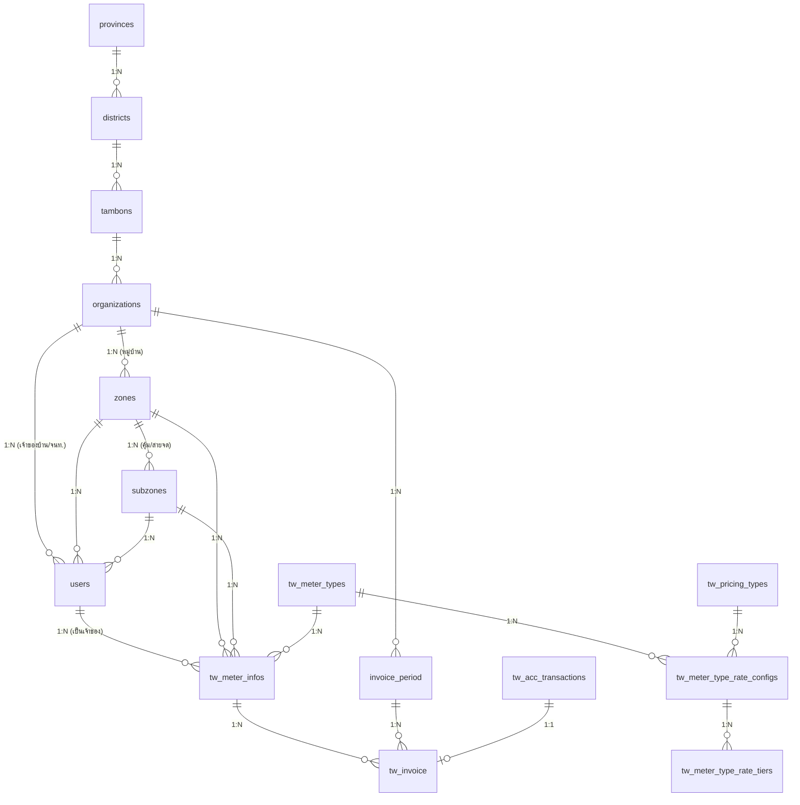

# Database Schema Documentation — Water Smart Bill

> **กฎเหล็ก (Mandatory Rule):** ทุกครั้งที่มีการเพิ่ม แก้ไข หรือเปลี่ยนแปลงโครงสร้างฐานข้อมูลใน `backend/db/migrations/` ต้องอัปเดตเอกสารฉบับนี้ (`docs/database/schema.md`) เสมอ

---

## 1. แผนผังความสัมพันธ์ของฐานข้อมูล (Entity-Relationship Diagram)

---

## 2. รายละเอียดตารางทั้งหมด (Table Definitions)

### 2.1 ข้อมูลพื้นที่และองค์การบริหารส่วนตำบล (`provinces`, `districts`, `tambons`, `organizations`, `zones`, `subzones`)

#### ตาราง `provinces` (จังหวัด)
| คอลัมน์ | ชนิดข้อมูล | ข้อจำกัด (Constraints) | คำอธิบาย |
| :--- | :--- | :--- | :--- |
| `id` | `BIGINT` | `PRIMARY KEY` | รหัสจังหวัด (เช่น `35` ยโสธร, `47` สกลนคร) |
| `province_name` | `VARCHAR(191)` | `NOT NULL` | ชื่อจังหวัด |
| `created_at` | `TIMESTAMPTZ` | `DEFAULT NOW()` | วันเวลาที่สร้าง |
| `updated_at` | `TIMESTAMPTZ` | `DEFAULT NOW()` | วันเวลาที่แก้ไขล่าสุด |

#### ตาราง `districts` (อำเภอ)
| คอลัมน์ | ชนิดข้อมูล | ข้อจำกัด (Constraints) | คำอธิบาย |
| :--- | :--- | :--- | :--- |
| `id` | `BIGINT` | `PRIMARY KEY` | รหัสอำเภอ |
| `district_name` | `VARCHAR(191)` | `NOT NULL` | ชื่ออำเภอ |
| `province_id` | `BIGINT` | `NOT NULL REFERENCES provinces(id)` | รหัสจังหวัด |
| `created_at` | `TIMESTAMPTZ` | `DEFAULT NOW()` | วันเวลาที่สร้าง |
| `updated_at` | `TIMESTAMPTZ` | `DEFAULT NOW()` | วันเวลาที่แก้ไขล่าสุด |

#### ตาราง `tambons` (ตำบล)
| คอลัมน์ | ชนิดข้อมูล | ข้อจำกัด (Constraints) | คำอธิบาย |
| :--- | :--- | :--- | :--- |
| `id` | `BIGINT` | `PRIMARY KEY` | รหัสตำบล |
| `tambon_name` | `VARCHAR(191)` | `NOT NULL` | ชื่อตำบล |
| `district_id` | `BIGINT` | `NOT NULL REFERENCES districts(id)` | รหัสอำเภอ |
| `zipcode` | `VARCHAR(10)` | `NOT NULL` | รหัสไปรษณีย์ |
| `created_at` | `TIMESTAMPTZ` | `DEFAULT NOW()` | วันเวลาที่สร้าง |
| `updated_at` | `TIMESTAMPTZ` | `DEFAULT NOW()` | วันเวลาที่แก้ไขล่าสุด |

#### ตาราง `organizations` (ข้อมูล อบต.)
| คอลัมน์ | ชนิดข้อมูล | ข้อจำกัด (Constraints) | คำอธิบาย |
| :--- | :--- | :--- | :--- |
| `id` | `BIGINT` | `PK GENERATED BY DEFAULT AS IDENTITY` | รหัสอ้างอิง อบต. (`org_id`) |
| `org_code` | `VARCHAR(100)` | `NOT NULL UNIQUE` | รัหสองค์กร (เช่น `HSG1`, `TNG1`) |
| `org_name` | `VARCHAR(191)` | `NOT NULL` | ชื่อ อบต. (เช่น อบต.ห้องแซง) |
| `org_address` | `TEXT` | | ที่ตั้งสำนักงาน อบต. |
| `org_tambon_id_fk` | `BIGINT` | `REFERENCES tambons(id)` | ตำบลที่ตั้ง |
| `org_district_id_fk` | `BIGINT` | `REFERENCES districts(id)` | อำเภอที่ตั้ง |
| `org_province_id_fk` | `BIGINT` | `REFERENCES provinces(id)` | จังหวัดที่ตั้ง |
| `org_zipcode` | `VARCHAR(10)` | | รหัสไปรษณีย์ |
| `org_phone` | `VARCHAR(191)` | | เบอร์โทรศัพท์ อบต. |
| `org_dept_name` | `VARCHAR(191)` | | ชื่อกองการประปา / หน่วยงานรับผิดชอบ |
| `org_head_name` | `VARCHAR(191)` | | ชื่อนายก อบต. / หัวหน้าหน่วยงาน |
| `fin_head_name` | `VARCHAR(191)` | | ชื่อผู้อำนวยการกองคลัง |
| `tw_head_name` | `VARCHAR(191)` | | ชื่อหัวหน้างานประปา |
| `org_logo_img` | `VARCHAR(255)` | | URL โลโก้ อบต. |
| `meternumbercode` | `VARCHAR(50)` | `DEFAULT 'M'` | Prefix รหัสมิเตอร์น้ำ |
| `cutmeter_count` | `INTEGER` | `NOT NULL DEFAULT 3` | จำนวนงวดค้างชำระก่อนแจ้งตัดมิเตอร์ |
| `vat` | `NUMERIC(18,4)` | `NOT NULL DEFAULT 7.0000` | อัตราภาษีมูลค่าเพิ่ม (%) |
| `lat` | `VARCHAR(50)` | `NOT NULL DEFAULT '15.8000'` | พิกัดละติจูด |
| `long` | `VARCHAR(50)` | `NOT NULL DEFAULT '104.1000'` | พิกัดลองจิจูด |
| `created_at` | `TIMESTAMPTZ` | `DEFAULT NOW()` | วันเวลาที่สร้าง |
| `updated_at` | `TIMESTAMPTZ` | `DEFAULT NOW()` | วันเวลาที่แก้ไขล่าสุด |

#### ตาราง `zones` (ข้อมูลหมู่บ้าน)
| คอลัมน์ | ชนิดข้อมูล | ข้อจำกัด (Constraints) | คำอธิบาย |
| :--- | :--- | :--- | :--- |
| `id` | `BIGINT` | `PK GENERATED BY DEFAULT AS IDENTITY` | รหัสหมู่บ้าน |
| `org_id` | `BIGINT` | `NOT NULL REFERENCES organizations(id)` | รหัส อบต. |
| `tambon_id` | `BIGINT` | `NOT NULL REFERENCES tambons(id)` | รหัสตำบล |
| `moo_no` | `INTEGER` | `NOT NULL DEFAULT 1` | หมู่ที่ (เช่น หมู่ที่ 1, 2, 3) |
| `zone_name` | `VARCHAR(191)` | `NOT NULL` | ชื่อหมู่บ้าน (เช่น หมู่ที่ 1 บ้านห้องแซง) |
| `location` | `TEXT` | `NOT NULL DEFAULT ''` | รายละเอียดพื้นที่ |
| `status` | `TEXT` | `CHECK (status IN ('active', 'inactive'))` | สถานะการใช้งาน |
| `lat` | `VARCHAR(50)` | `NOT NULL DEFAULT '15.8000'` | ละติจูด |
| `long` | `VARCHAR(50)` | `NOT NULL DEFAULT '104.1000'` | ลองจิจูด |
| `created_at` | `TIMESTAMPTZ` | `DEFAULT NOW()` | วันเวลาที่สร้าง |
| `updated_at` | `TIMESTAMPTZ` | `DEFAULT NOW()` | วันเวลาที่แก้ไขล่าสุด |

#### ตาราง `subzones` (ข้อมูลคุ้ม / สายจดมิเตอร์ย่อยในหมู่บ้าน)
| คอลัมน์ | ชนิดข้อมูล | ข้อจำกัด (Constraints) | คำอธิบาย |
| :--- | :--- | :--- | :--- |
| `id` | `BIGINT` | `PK GENERATED BY DEFAULT AS IDENTITY` | รหัสคุ้ม/สายจดมิเตอร์ |
| `org_id` | `BIGINT` | `NOT NULL REFERENCES organizations(id)` | รหัส อบต. |
| `zone_id` | `BIGINT` | `NOT NULL REFERENCES zones(id)` | รหัสหมู่บ้านหลัก |
| `subzone_name` | `VARCHAR(191)` | `NOT NULL` | ชื่อคุ้ม / สายจดมิเตอร์ |
| `status` | `TEXT` | `CHECK (status IN ('active', 'inactive'))` | สถานะการใช้งาน |
| `created_at` | `TIMESTAMPTZ` | `DEFAULT NOW()` | วันเวลาที่สร้าง |
| `updated_at` | `TIMESTAMPTZ` | `DEFAULT NOW()` | วันเวลาที่แก้ไขล่าสุด |

---

### 2.2 ข้อมูลบ้านเลขที่และเจ้าของบ้าน (`users`)

| คอลัมน์ | ชนิดข้อมูล | ข้อจำกัด (Constraints) | คำอธิบาย |
| :--- | :--- | :--- | :--- |
| `id` | `BIGINT` | `PK GENERATED BY DEFAULT AS IDENTITY` | รหัสผู้ใช้งาน/เจ้าของบ้าน |
| `org_id` | `BIGINT` | `NOT NULL REFERENCES organizations(id)` | รหัส อบต. |
| `username` | `VARCHAR(191)` | `NOT NULL UNIQUE` | ชื่อบัญชีผู้ใช้ |
| `prefix` | `VARCHAR(50)` | `DEFAULT ''` | คำนำหน้าชื่อ (นาย, นาง, นางสาว) |
| `firstname` | `VARCHAR(191)` | `NOT NULL` | ชื่อจริงเจ้าของบ้าน |
| `lastname` | `VARCHAR(191)` | `DEFAULT ''` | นามสกุลเจ้าของบ้าน |
| `house_no` | `VARCHAR(50)` | `NOT NULL DEFAULT ''` | บ้านเลขที่ (เช่น `123/4`) |
| `address` | `VARCHAR(255)` | `DEFAULT ''` | ที่อยู่เต็ม |
| `zone_id` | `BIGINT` | `NOT NULL REFERENCES zones(id)` | หมู่บ้าน |
| `subzone_id` | `BIGINT` | `NOT NULL REFERENCES subzones(id)` | คุ้ม/สายจดมิเตอร์ |
| `tambon_code` | `BIGINT` | `NOT NULL REFERENCES tambons(id)` | รหัสตำบล |
| `district_code` | `BIGINT` | `NOT NULL REFERENCES districts(id)` | รหัสอำเภอ |
| `province_code` | `BIGINT` | `NOT NULL REFERENCES provinces(id)` | รหัสจังหวัด |
| `phone` | `VARCHAR(50)` | `DEFAULT ''` | เบอร์โทรศัพท์ |
| `email` | `VARCHAR(191)` | | อีเมล |
| `id_card` | `VARCHAR(20)` | | เลขประจำตัวประชาชน (ถ้ามี) |
| `line_user_id` | `VARCHAR(191)` | `DEFAULT ''` | รหัส LINE User ID สำหรับเชื่อม LINE LIFF |
| `image` | `TEXT` | `DEFAULT ''` | URL รูป Avatar (ถ้าว่าง ระบบใช้ Default Avatar อัตโนมัติ) |
| `status` | `TEXT` | `CHECK (status IN ('active', 'inactive', 'deleted'))` | สถานะ |
| `created_at` | `TIMESTAMPTZ` | `DEFAULT NOW()` | วันเวลาที่สร้าง |
| `updated_at` | `TIMESTAMPTZ` | `DEFAULT NOW()` | วันเวลาที่แก้ไขล่าสุด |

---

### 2.3 ข้อมูลหน่วยน้ำและอัตราค่าน้ำ (`tw_pricing_types`, `tw_meter_types`, `tw_meter_type_rate_configs`, `tw_meter_type_rate_tiers`, `invoice_period`)

#### ตาราง `tw_pricing_types` (รูปแบบการคิดราคา)
| คอลัมน์ | ชนิดข้อมูล | ข้อจำกัด (Constraints) | คำอธิบาย |
| :--- | :--- | :--- | :--- |
| `id` | `BIGINT` | `PK GENERATED BY DEFAULT AS IDENTITY` | รหัสรูปแบบราคา |
| `name` | `VARCHAR(191)` | `NOT NULL UNIQUE` | ชื่อรูปแบบ (`progressive` ขั้นบันได, `flat` คงที่) |
| `description` | `TEXT` | | คำอธิบาย |

#### ตาราง `tw_meter_types` (ประเภทมาตรวัดน้ำ)
| คอลัมน์ | ชนิดข้อมูล | ข้อจำกัด (Constraints) | คำอธิบาย |
| :--- | :--- | :--- | :--- |
| `id` | `BIGINT` | `PK GENERATED BY DEFAULT AS IDENTITY` | รหัสประเภทมิเตอร์ |
| `org_id` | `BIGINT` | `NOT NULL REFERENCES organizations(id)` | รหัส อบต. |
| `meter_type_name` | `VARCHAR(191)` | `NOT NULL` | ชื่อประเภท (เช่น ประปาครัวเรือน, การค้า/พาณิชย์) |
| `description` | `VARCHAR(191)` | | รายละเอียด |
| `metersize` | `INTEGER` | `NOT NULL DEFAULT 4` | ขนาดมิเตอร์ (หุน) |
| `reserve_fee` | `NUMERIC(18,4)` | `NOT NULL DEFAULT 10.0000` | ค่ารักษามาตรวัดน้ำประจำเดือน (บาท) |

#### ตาราง `tw_meter_type_rate_configs` (การตั้งค่าอัตราค่าน้ำต่อประเภทมิเตอร์)
| คอลัมน์ | ชนิดข้อมูล | ข้อจำกัด (Constraints) | คำอธิบาย |
| :--- | :--- | :--- | :--- |
| `id` | `BIGINT` | `PK GENERATED BY DEFAULT AS IDENTITY` | รหัสการตั้งค่าเรทค่าน้ำ |
| `org_id` | `BIGINT` | `NOT NULL REFERENCES organizations(id)` | รหัส อบต. |
| `meter_type_id_fk` | `BIGINT` | `NOT NULL REFERENCES tw_meter_types(id)` | ประเภทมิเตอร์ |
| `pricing_type_id` | `BIGINT` | `NOT NULL REFERENCES tw_pricing_types(id)` | รูปแบบการคำนวณ |
| `min_usage_charge` | `NUMERIC(18,4)` | `DEFAULT 0` | ค่าน้ำขั้นต่ำ |
| `vat` | `NUMERIC(18,4)` | `NOT NULL DEFAULT 7.0000` | อัตราภาษีมูลค่าเพิ่ม (%) |
| `fixed_rate_per_unit` | `NUMERIC(18,4)` | | ราคาคงที่ต่อหน่วย (กรณีใช้เรทคงที่) |
| `effective_date` | `DATE` | `NOT NULL DEFAULT CURRENT_DATE` | วันที่เริ่มมีผล |
| `is_active` | `BOOLEAN` | `NOT NULL DEFAULT TRUE` | สถานะใช้งาน |

#### ตาราง `tw_meter_type_rate_tiers` (ขั้นบันไดอัตราค่าน้ำต่อหน่วย)
| คอลัมน์ | ชนิดข้อมูล | ข้อจำกัด (Constraints) | คำอธิบาย |
| :--- | :--- | :--- | :--- |
| `id` | `BIGINT` | `PK GENERATED BY DEFAULT AS IDENTITY` | รหัสขั้นบันได |
| `meter_type_rate_config_id` | `BIGINT` | `NOT NULL REFERENCES tw_meter_type_rate_configs(id)` | รหัสชุดการตั้งค่าเรทค่าน้ำ |
| `tier_order` | `INTEGER` | `NOT NULL` | ลำดับขั้นที่ (1, 2, 3, ...) |
| `min_units` | `INTEGER` | `NOT NULL` | หน่วยเริ่มต้นของขั้นนี้ |
| `max_units` | `INTEGER` | `NULLABLE` | หน่วยสูงสุดของขั้นนี้ (`NULL` = ไม่จำกัด) |
| `rate_per_unit` | `NUMERIC(18,4)` | `NOT NULL` | อัตราค่าน้ำต่อหน่วย (บาท / ลบ.ม.) |
| `comment` | `TEXT` | | คำอธิบายขั้นบันได |

#### ตาราง `invoice_period` (รอบบิลประจำเดือน)
| คอลัมน์ | ชนิดข้อมูล | ข้อจำกัด (Constraints) | คำอธิบาย |
| :--- | :--- | :--- | :--- |
| `id` | `BIGINT` | `PK GENERATED BY DEFAULT AS IDENTITY` | รหัสรอบบิล |
| `org_id` | `BIGINT` | `NOT NULL REFERENCES organizations(id)` | รหัส อบต. |
| `inv_p_name` | `VARCHAR(100)` | `NOT NULL` | ชื่องวดบิล (เช่น `11/2569`) |
| `startdate` | `DATE` | `NOT NULL` | วันเริ่มต้นรอบบิล |
| `enddate` | `DATE` | `NOT NULL` | วันสิ้นสุดรอบบิล / วันครบกำหนดชำระ |
| `status` | `TEXT` | `CHECK (status IN ('active', 'closed', 'deleted'))` | สถานะรอบบิล |

---

### 2.4 ข้อมูลมิเตอร์น้ำ การจดมิเตอร์ และใบแจ้งหนี้/ใบเสร็จ (`tw_meter_infos`, `tw_invoice`, `tw_acc_transactions`)

#### ตาราง `tw_meter_infos` (ทะเบียนมิเตอร์น้ำประปา)
| คอลัมน์ | ชนิดข้อมูล | ข้อจำกัด (Constraints) | คำอธิบาย |
| :--- | :--- | :--- | :--- |
| `meter_id` | `BIGINT` | `PK GENERATED BY DEFAULT AS IDENTITY` | รหัสมิเตอร์น้ำ |
| `org_id` | `BIGINT` | `NOT NULL REFERENCES organizations(id)` | รหัส อบต. |
| `user_id` | `BIGINT` | `NOT NULL REFERENCES users(id)` | รหัสเจ้าของบ้าน |
| `meternumber` | `VARCHAR(191)` | `NOT NULL UNIQUE` | เลขทะเบียนมิเตอร์น้ำ (เช่น `HSG-0001`) |
| `factory_no` | `VARCHAR(191)` | `NOT NULL DEFAULT ''` | เลขตัวถังมิเตอร์จากโรงงาน |
| `submeter_name` | `VARCHAR(191)` | `NOT NULL` | ชื่อผู้ใช้น้ำที่แสดงบนบิล |
| `meter_address` | `VARCHAR(191)` | `NOT NULL` | บ้านเลขที่/ที่อยู่ติดตั้งมิเตอร์ |
| `undertake_zone_id` | `BIGINT` | `NOT NULL REFERENCES zones(id)` | หมู่บ้านที่ติดตั้ง |
| `undertake_subzone_id` | `BIGINT` | `NOT NULL REFERENCES subzones(id)` | คุ้ม/สายจดมิเตอร์ |
| `metertype_id` | `BIGINT` | `REFERENCES tw_meter_types(id)` | ประเภทมิเตอร์ |
| `acceptance_date` | `DATE` | `NOT NULL DEFAULT CURRENT_DATE` | วันที่ติดตั้ง/ขึ้นทะเบียน |
| `status` | `TEXT` | `CHECK (status IN ('active', 'inactive', 'deleted'))` | สถานะมิเตอร์ |
| `owe_count` | `INTEGER` | `NOT NULL DEFAULT 0` | จำนวนงวดที่ค้างชำระ |
| `cutmeter` | `TEXT` | `CHECK (cutmeter IN ('0', '1'))` | สถานะตัดมิเตอร์ (`0`=ปกติ, `1`=ถูกตัด) |
| `last_meter_recording` | `INTEGER` | `NOT NULL DEFAULT 0` | เลขมิเตอร์ล่าสุดที่บันทึกไว้ |
| `created_at` | `TIMESTAMPTZ` | `DEFAULT NOW()` | วันเวลาที่สร้าง |
| `updated_at` | `TIMESTAMPTZ` | `DEFAULT NOW()` | วันเวลาที่แก้ไขล่าสุด |

#### ตาราง `tw_invoice` (ใบแจ้งหนี้ค่าน้ำประปาและประวัติการจดมิเตอร์)
| คอลัมน์ | ชนิดข้อมูล | ข้อจำกัด (Constraints) | คำอธิบาย |
| :--- | :--- | :--- | :--- |
| `id` | `BIGINT` | `PK GENERATED BY DEFAULT AS IDENTITY` | รหัสใบแจ้งหนี้ |
| `inv_no` | `VARCHAR(191)` | `NOT NULL UNIQUE` | เลขที่ใบแจ้งหนี้ |
| `client_reading_id` | `VARCHAR(100)` | `UNIQUE` | UUID สำหรับป้องกันการซิงค์ซ้ำจากโหมด Offline |
| `org_id` | `BIGINT` | `NOT NULL REFERENCES organizations(id)` | รหัส อบต. |
| `meter_id_fk` | `BIGINT` | `NOT NULL REFERENCES tw_meter_infos(meter_id)` | รหัสมิเตอร์น้ำ |
| `inv_period_id_fk` | `BIGINT` | `NOT NULL REFERENCES invoice_period(id)` | รหัสรอบบิล |
| `lastmeter` | `NUMERIC(18,4)` | `NOT NULL` | เลขมิเตอร์ครั้งก่อน |
| `currentmeter` | `NUMERIC(18,4)` | `NOT NULL` | เลขมิเตอร์ครั้งนี้ |
| `water_used` | `NUMERIC(18,4)` | `NOT NULL` | จำนวนหน่วยน้ำที่ใช้ (ลบ.ม.) |
| `paid` | `NUMERIC(18,4)` | `NOT NULL` | ค่าน้ำประปาตามขั้นบันได (ก่อน VAT) |
| `reserve_meter` | `NUMERIC(18,4)` | `NOT NULL` | ค่ารักษามาตรวัดน้ำ |
| `vat` | `NUMERIC(18,4)` | `NOT NULL` | ภาษีมูลค่าเพิ่ม 7% |
| `totalpaid` | `NUMERIC(18,4)` | `NOT NULL` | ยอดรวมที่ต้องชำระทั้งสิ้น (บาท) |
| `reading_photo_url` | `TEXT` | `DEFAULT ''` | รูปถ่ายหน้าปัดมิเตอร์น้ำ |
| `ocr_text` | `VARCHAR(50)` | `DEFAULT ''` | ค่าตัวเลขที่อ่านได้จาก OCR |
| `ocr_confidence` | `NUMERIC(5,2)` | `DEFAULT 0` | ความมั่นใจของ OCR (%) |
| `status` | `TEXT` | `CHECK (status IN ('init', 'invoice', 'paid', 'owe', 'deleted'))` | สถานะบิล (`invoice`=รอชำระ, `paid`=ชำระแล้ว) |
| `payment_method` | `VARCHAR(50)` | `DEFAULT ''` | ช่องทางชำระเงิน (`cash`, `promptpay`, `qr`) |
| `receipt_no` | `VARCHAR(100)` | `DEFAULT ''` | เลขที่ใบเสร็จรับเงินอย่างเป็นทางการ (`RC-YYYYMM-XXXX`) |
| `paid_at` | `TIMESTAMPTZ` | | วันเวลาที่รับชำระเงินจริง |
| `cashier_id` | `BIGINT` | | รหัสเจ้าหน้าที่การเงินผู้รับเงิน |
| `acc_trans_id_fk` | `BIGINT` | `REFERENCES tw_acc_transactions(id)` | รหัสธุรกรรมการรับชำระเงิน |
| `recorder_id` | `BIGINT` | | รหัสเจ้าหน้าที่ผู้จดมิเตอร์ |
| `recorded_at` | `TIMESTAMPTZ` | `DEFAULT NOW()` | วันเวลาที่จดมิเตอร์จริงหน้างาน |
| `synced_at` | `TIMESTAMPTZ` | `DEFAULT NOW()` | วันเวลาที่ซิงค์เข้าฐานข้อมูล |
| `created_at` | `TIMESTAMPTZ` | `DEFAULT NOW()` | วันเวลาที่สร้าง |
| `updated_at` | `TIMESTAMPTZ` | `DEFAULT NOW()` | วันเวลาที่แก้ไขล่าสุด |

#### ตาราง `tw_acc_transactions` (รายการรับชำระเงินและใบเสร็จ)
| คอลัมน์ | ชนิดข้อมูล | ข้อจำกัด (Constraints) | คำอธิบาย |
| :--- | :--- | :--- | :--- |
| `id` | `BIGINT` | `PK GENERATED BY DEFAULT AS IDENTITY` | รหัสใบเสร็จ/การรับชำระ |
| `org_id` | `BIGINT` | `NOT NULL REFERENCES organizations(id)` | รหัส อบต. |
| `meter_id_fk` | `BIGINT` | `NOT NULL REFERENCES tw_meter_infos(meter_id)` | รหัสมิเตอร์น้ำ |
| `paidsum` | `NUMERIC(18,4)` | `NOT NULL DEFAULT 0` | ยอดค่าน้ำ |
| `vatsum` | `NUMERIC(18,4)` | `NOT NULL DEFAULT 0` | ยอดภาษีมูลค่าเพิ่ม |
| `reserve_meter_sum` | `NUMERIC(18,4)` | `NOT NULL DEFAULT 0` | ยอดค่ารักษามิเตอร์ |
| `totalpaidsum` | `NUMERIC(18,4)` | `NOT NULL DEFAULT 0` | ยอดรับชำระสุทธิ |
| `payment_method` | `VARCHAR(50)` | `NOT NULL DEFAULT 'cash'` | ช่องทางชำระเงิน (`cash`, `qr_promptpay`, `transfer`) |
| `status` | `TEXT` | `CHECK (status IN ('1', '0'))` | สถานะ (`1`=สำเร็จ, `0`=ยกเลิก) |
| `cashier` | `BIGINT` | `NOT NULL` | รหัสเจ้าหน้าที่ผู้รับเงิน |
| `created_at` | `TIMESTAMPTZ` | `DEFAULT NOW()` | วันเวลาที่รับชำระ |
| `updated_at` | `TIMESTAMPTZ` | `DEFAULT NOW()` | วันเวลาที่แก้ไขล่าสุด |

---

## 3. ประวัติการเปลี่ยนแปลง Schema (Schema Changelog)

| วันที่ | Migration File | รายละเอียดการเปลี่ยนแปลง | ADR อ้างอิง |
| :---: | :--- | :--- | :---: |
| 2026-11-18 | `000001_water_smart_bill_schema.up.sql` | สร้างตารางหลักของระบบ Water Smart Bill พร้อมเพิ่ม `house_no`, Default Avatar support, `client_reading_id` สำหรับ Offline Sync, และ `reading_photo_url` / `ocr_confidence` สำหรับระบบ OCR | [ADR 0002](../adr/0002-water-smart-bill-system-architecture.md), [ADR 0003](../adr/0003-offline-first-sync-bluetooth-escpos-and-hybrid-ocr.md) |
| 2026-11-18 | `000002_enable_rls.up.sql` | เปิดใช้งาน PostgreSQL Row-Level Security (RLS) แยกข้อมูลตาม `org_id` | [ADR 0002](../adr/0002-water-smart-bill-system-architecture.md) |
| 2026-11-18 | `000003_add_payment_receipt_fields.up.sql` | เพิ่มคอลัมน์ `payment_method`, `receipt_no`, `paid_at`, `cashier_id` บนตาราง `tw_invoice` สำหรับระบบโต๊ะการเงินและออกใบเสร็จ | [ADR 0006](../adr/0006-finance-cashier-invoicing-receipts-and-csv-export.md) |
